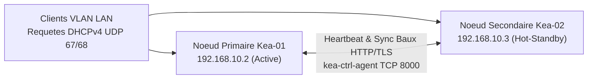

<!-- MASTER-HEADER-START -->
<div align="center">

<a href="https://0xcyberlitech.com/">
  
</a>

<p align="center">
  <a href="https://0xcyberlitech.com/"></a>
  <a href="https://0xcyberlitech.com/soc-rd.html"></a>
  <a href="https://0xcyberlitech.com/jarvis-rd.html"></a>
  <a href="https://github.com/0xCyberLiTech?tab=repositories"></a>
</p>
<p align="center">
  <a href="README.md"></a>
</p>


</div>
<!-- MASTER-HEADER-END -->

<!-- DEBIAN-TRUTH-START -->
> [!IMPORTANT]
>  ** Matrice Officielle Debian — `Debian 12 (Bookworm)` · `Debian 13 (Trixie)` · `Debian 14 (Forky)`**
> - **Sources Officielles Debian.org (`kea`) :** `Bookworm (12)` : **`Stable-12`** &nbsp;·&nbsp; `Trixie (13 — Stable)` : **`Stable-13`** &nbsp;·&nbsp; `Forky (14 — Next-Gen)` : **`Testing-14`**
> - **Références Officielles :** [Paquet Debian Trixie (`kea-dhcp4-server`)](https://packages.debian.org/trixie/kea-dhcp4-server) &nbsp;·&nbsp; [Paquet Debian Forky (`kea-dhcp4-server`)](https://packages.debian.org/forky/kea-dhcp4-server) &nbsp;·&nbsp; [Documentation Officielle Debian](https://wiki.debian.org/DHCP_Server)
> - **Note d'Ingénierie (Divergence 13 vs 14) :** Point de vigilance majeur Debian 13 (Trixie) & Debian 14 (Forky) : `isc-dhcp-server` est déclaré End-of-Life par l'ISC ; Debian recommande désormais officiellement **ISC Kea (`kea-dhcp4-server`)** pour tout nouveau déploiement.

<details>
<summary> <b>Afficher les Encarts Ligne de Commande : Debian 13 (Trixie — Stable) vs Debian 14 (Forky — Next-Gen)</b></summary>

####  Profil Production Stable — Commandes pour `Debian 13 (Trixie)`
```bash
# Debian 13 (Trixie) — Service DHCP (migration officielle d'isc-dhcp-server vers ISC Kea) :
sudo apt update && sudo apt install -y kea-dhcp4-server
sudo systemctl status kea-dhcp4-server && sudo journalctl -u kea-dhcp4-server -n 30
```

####  Profil Anticipation Next-Gen — Commandes pour `Debian 14 (Forky)`
```bash
# Debian 14 (Forky) — ISC Kea DHCPv4/v6 natif (isc-dhcp-server est EoL chez ISC) :
sudo kea-dhcp4 -t /etc/kea/kea-dhcp4.conf
sudo systemctl reload-or-restart kea-dhcp4-server
```

</details>
<!-- DEBIAN-TRUTH-END -->

<!-- CIEL-PEDAGOGY-START -->
<details>
<summary> <b>Synthèse d'Architecture, Standards Officiels &amp; Diagnostic (Niveau 1 : Fondamentaux · Niveau 2 : Repères · Niveau 3 : Diagnostic)</b></summary>

- **Niveau 1 — Fondamentaux &amp; Principe d'Architecture :** Le serveur **DHCP** automatise l'attribution dynamique et centralisée des paramètres IPv4/IPv6 (adresse IP, masque CIDR, passerelle par défaut `option routers`, serveurs DNS et NTP) à chaque équipement du réseau selon le cycle protocolaire **DORA** (*Discover, Offer, Request, Acknowledge*).
- **Niveau 2 — Repères Officiels (Ports IANA, Fichiers Debian &amp; Commandes de Validation) :** **Ports IANA :** `UDP 67` (Serveur) / `UDP 68` (Client) · `TCP 8000` (Agent REST/HA Kea) &nbsp;|&nbsp; **Fichiers Debian :** `/etc/kea/kea-dhcp4.conf` · Baux actifs `/var/lib/kea/kea-leases4.csv` &nbsp;|&nbsp; **Validation officielle :** `sudo kea-dhcp4 -t /etc/kea/kea-dhcp4.conf`.
- **Niveau 3 — Diagnostic d'Incidents &amp; Ingénierie Avancée :** **Diagnostic & Architecture :** En cas d'échec au démarrage, vérifiez que l'interface réseau déclarée possède une IP statique appartenant au sous-réseau distribué. Sous Debian 13/14, `ISC Kea` remplace définitivement `isc-dhcp-server` (EoL) en apportant un moteur JSON, une API REST sans coupure et un failover natif (`libdhcp_ha.so`).
- **Sources de Vérité Officielles Éditeurs &amp; Standards :** [Documentation Officielle ISC Kea (ReadTheDocs)](https://kea.readthedocs.io/) &nbsp;·&nbsp; [RFC 2131 (DHCPv4 IETF)](https://datatracker.ietf.org/doc/html/rfc2131) &nbsp;·&nbsp; [Wiki Officiel Debian DHCP](https://wiki.debian.org/DHCP_Server)

</details>
<!-- CIEL-PEDAGOGY-END -->


#  Migration d'ISC DHCP (EoL) vers ISC Kea DHCPv4/v6 & Cluster Haute Disponibilité sur Debian 12, 13 (Trixie) & 14 (Forky)

> **Objectif Opérationnel :** Migrer proprement un serveur **`isc-dhcp-server`** (déclaré *End-of-Life* par l'Internet Systems Consortium) vers le nouveau standard officiel **ISC Kea DHCP (`kea-dhcp4-server` 2.6+ / 3.0)** sous **Debian 12 (Bookworm)**, **Debian 13 (Trixie — Stable)** et **Debian 14 (Forky — Next-Gen)**, configurer les réservations MAC/IP en JSON moderne et déployer un cluster **Haute Disponibilité (HA Hot-Standby / Load-Balancing)** via l'agent `kea-ctrl-agent`.

| Étape | Description Technique | Accès Direct |
|:---:|:---|:---:|
| **01** | Pourquoi migrer d'`isc-dhcp-server` vers ISC Kea sous Debian 13 & 14 ? | [](#pourquoi-migrer-vers-isc-kea) |
| **02** | Installation native d'ISC Kea (`kea-dhcp4-server`) & `kea-ctrl-agent` | [](#installation-native-isc-kea) |
| **03** | Configuration JSON complète (`/etc/kea/kea-dhcp4.conf`) & Réservations | [](#configuration-json-kea-dhcp4) |
| **04** | Architecture & Configuration du Cluster Haute Disponibilité (`libdhcp_ha.so`) | [](#cluster-haute-disponibilite-kea) |
| **05** | Validation syntaxique, journaux `journalctl` & Audit des baux LFC | [](#validation-et-exploitation-kea) |

---

<a id="pourquoi-migrer-vers-isc-kea"></a>
##  01 // Pourquoi migrer d'isc-dhcp-server vers ISC Kea sous Debian 13 & 14 ?


Le démon historique `isc-dhcp-server` (écrit dans les années 1990) n'est plus maintenu par l'ISC depuis fin 2022. Dès **Debian 13 (Trixie — Stable)** et **Debian 14 (Forky — Next-Gen)**, Debian recommande officiellement **ISC Kea** pour toute infrastructure réseau d'entreprise ou de laboratoire :

- **Rechargement à chaud sans coupure** via API REST (`kea-ctrl-agent`) et sockets UNIX (`/run/kea/kea4-ctrl-socket`).
- **Configuration structurée JSON** vérifiable avant application (`kea-dhcp4 -t`).
- **Haute Disponibilité native (`libdhcp_ha.so`)** supportant plus de 2 nœuds, avec synchronisation temps réel des baux et bascule automatique (*Hot-Standby* ou *Load-Balancing*).



---

<a id="installation-native-isc-kea"></a>
##  02 // Installation native d'ISC Kea (kea-dhcp4-server) & kea-ctrl-agent


Sur vos deux serveurs **Debian 12 (Bookworm)**, **Debian 13 (Trixie)** ou **Debian 14 (Forky)**, installez le serveur DHCPv4, l'agent de contrôle REST et la bibliothèque de hooks Haute Disponibilité :

<!-- CODE-WINDOW-START -->
> [!CAUTION]
> 
>
> ```bash
> sudo apt update
> sudo apt install -y kea-dhcp4-server kea-ctrl-agent kea-common jq
> ```
<!-- CODE-WINDOW-END -->

Si vous migrez depuis un serveur où `isc-dhcp-server` tournait encore, arrêtez et désactivez l'ancien démon pour libérer le port UDP `67` :

<!-- CODE-WINDOW-START -->
> [!CAUTION]
> 
>
> ```bash
> sudo systemctl stop isc-dhcp-server 2>/dev/null || true
> sudo systemctl disable isc-dhcp-server 2>/dev/null || true
> ```
<!-- CODE-WINDOW-END -->

---

<a id="configuration-json-kea-dhcp4"></a>
##  03 // Configuration JSON complète (/etc/kea/kea-dhcp4.conf) & Réservations


Sauvegardez le fichier d'origine puis rédigez `/etc/kea/kea-dhcp4.conf` en remplaçant `eth0` par le nom de votre interface réseau (`ip -c link`) :

<!-- CODE-WINDOW-START -->
> [!CAUTION]
> 
>
> ```bash
> sudo cp /etc/kea/kea-dhcp4.conf /etc/kea/kea-dhcp4.conf.orig
> sudo nano /etc/kea/kea-dhcp4.conf
> ```
<!-- CODE-WINDOW-END -->

Configuration de production pour un sous-réseau `192.168.10.0/24` avec passerelle, DNS, NTP et réservation statique MAC :

<!-- CODE-WINDOW-START -->
> [!CAUTION]
> 
>
> ```json
> {
>   "Dhcp4": {
>     "interfaces-config": {
>       "interfaces": [ "eth0" ]
>     },
>     "control-socket": {
>       "socket-type": "unix",
>       "socket-name": "/run/kea/kea4-ctrl-socket"
>     },
>     "lease-database": {
>       "type": "memfile",
>       "persist": true,
>       "name": "/var/lib/kea/kea-leases4.csv",
>       "lfc-interval": 3600
>     },
>     "valid-lifetime": 28800,
>     "renew-timer": 14400,
>     "rebind-timer": 25200,
>     "option-data": [
>       { "name": "routers", "data": "192.168.10.1" },
>       { "name": "domain-name-servers", "data": "192.168.10.2, 192.168.10.3" },
>       { "name": "domain-name", "data": "cyberlitech.lan" },
>       { "name": "ntp-servers", "data": "192.168.10.1" }
>     ],
>     "subnet4": [
>       {
>         "id": 10,
>         "subnet": "192.168.10.0/24",
>         "pools": [
>           { "pool": "192.168.10.100 - 192.168.10.220" }
>         ],
>         "reservations": [
>           {
>             "hw-address": "bc:24:11:45:8a:10",
>             "ip-address": "192.168.10.50",
>             "hostname": "srv-proxmox-01"
>           }
>         ]
>       }
>     ],
>     "loggers": [
>       {
>         "name": "kea-dhcp4",
>         "output_options": [
>           { "output": "stdout" }
>         ],
>         "severity": "INFO"
>       }
>     ]
>   }
> }
> ```
<!-- CODE-WINDOW-END -->

---

<a id="cluster-haute-disponibilite-kea"></a>
##  04 // Architecture & Configuration du Cluster Haute Disponibilité (libdhcp_ha.so)


Pour activer le failover automatique entre `kea-01` (`192.168.10.2`) et `kea-02` (`192.168.10.3`), ajoutez le bloc `hooks-libraries` dans `/etc/kea/kea-dhcp4.conf` :

<!-- CODE-WINDOW-START -->
> [!CAUTION]
> 
>
> ```json
>     "hooks-libraries": [
>       {
>         "library": "/usr/lib/x86_64-linux-gnu/kea/hooks/libdhcp_lease_cmds.so"
>       },
>       {
>         "library": "/usr/lib/x86_64-linux-gnu/kea/hooks/libdhcp_ha.so",
>         "parameters": {
>           "high-availability": [
>             {
>               "this-server-name": "kea-01",
>               "mode": "hot-standby",
>               "heartbeat-delay": 10000,
>               "max-response-delay": 45000,
>               "max-ack-delay": 5000,
>               "max-unacked-clients": 0,
>               "peers": [
>                 {
>                   "name": "kea-01",
>                   "url": "http://192.168.10.2:8000/",
>                   "role": "primary",
>                   "auto-failover": true
>                 },
>                 {
>                   "name": "kea-02",
>                   "url": "http://192.168.10.3:8000/",
>                   "role": "standby",
>                   "auto-failover": true
>                 }
>               ]
>             }
>           ]
>         }
>       }
>     ]
> ```
<!-- CODE-WINDOW-END -->

> Sur le serveur secondaire (`kea-02`), conservez exactement la même configuration en remplaçant uniquement `"this-server-name": "kea-01"` par `"this-server-name": "kea-02"`.

Autorisez le port de synchronisation HA (`8000/tcp`) uniquement entre les deux pairs dans UFW :

<!-- CODE-WINDOW-START -->
> [!CAUTION]
> 
>
> ```bash
> sudo ufw allow from 192.168.10.3 to any port 8000 proto tcp comment 'Kea HA Sync Peer'
> sudo ufw allow 67/udp comment 'Kea DHCPv4 Server'
> ```
<!-- CODE-WINDOW-END -->

---

<a id="validation-et-exploitation-kea"></a>
##  05 // Validation syntaxique, journaux journalctl & Audit des baux LFC


Avant tout redémarrage en production, validez systématiquement la syntaxe JSON avec l'option `-t` :

<!-- CODE-WINDOW-START -->
> [!CAUTION]
> 
>
> ```bash
> sudo kea-dhcp4 -t /etc/kea/kea-dhcp4.conf
> sudo kea-ctrl-agent -t /etc/kea/kea-ctrl-agent.conf
> ```
<!-- CODE-WINDOW-END -->

Activez et démarrez les services systemd :

<!-- CODE-WINDOW-START -->
> [!CAUTION]
> 
>
> ```bash
> sudo systemctl enable --now kea-dhcp4-server kea-ctrl-agent
> sudo systemctl status kea-dhcp4-server kea-ctrl-agent
> ```
<!-- CODE-WINDOW-END -->

Consultez les baux actifs et l'état du cluster Haute Disponibilité en temps réel :

<!-- CODE-WINDOW-START -->
> [!CAUTION]
> 
>
> ```bash
> sudo journalctl -u kea-dhcp4-server -n 40 --no-hostname
> sudo column -s, -t /var/lib/kea/kea-leases4.csv
> ```
<!-- CODE-WINDOW-END -->

<!-- MASTER-FOOTER-START -->
<div align="center">


<a href="https://0xcyberlitech.com/">
  
</a>

<p align="center"><a href="https://0xcyberlitech.com/"></a></p>

<sub><b>Architecturé &amp; Forgé par Marc &amp; Antigravity (Google DeepMind)</b> &nbsp;·&nbsp; <a href="https://0xcyberlitech.com/"><b>0xcyberlitech.com</b></a> &nbsp;·&nbsp; <a href="https://0xcyberlitech.com/soc-rd.html">Architecture SOC Cockpit v5.5</a> &nbsp;·&nbsp; <a href="https://0xcyberlitech.com/jarvis-rd.html">Architecture JARVIS Mark-VII</a> &nbsp;·&nbsp; <a href="https://0xcyberlitech.com/blueprint-jarvis.html">Blueprint Matériel RTX 5080</a></sub>

</div>
<!-- MASTER-FOOTER-END -->
