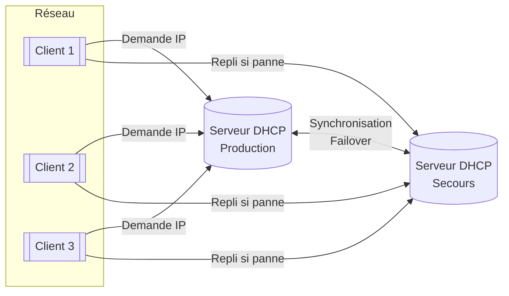
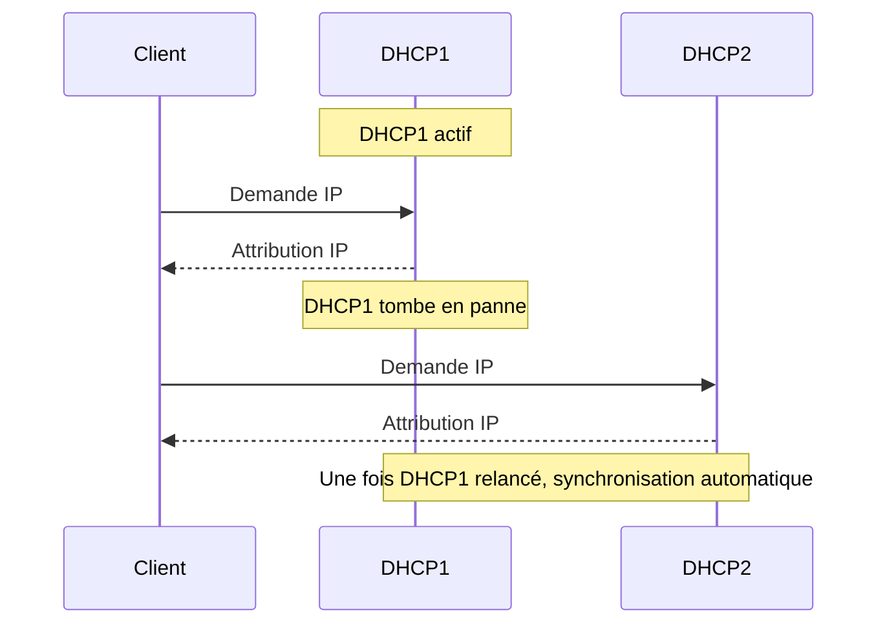

<!-- MASTER-HEADER-START -->
<div align="center">

<a href="https://0xcyberlitech.com/">
  
</a>

<p align="center">
  <a href="https://0xcyberlitech.com/"></a>
  <a href="https://0xcyberlitech.com/soc-rd.html"></a>
  <a href="https://0xcyberlitech.com/jarvis-rd.html"></a>
  <a href="https://github.com/0xCyberLiTech?tab=repositories"></a>
</p>
<p align="center">
  <a href="README.md"></a>
</p>


</div>
<!-- MASTER-HEADER-END -->

<!-- DEBIAN-TRUTH-START -->
> [!IMPORTANT]
>  ** Matrice Officielle Debian — `Debian 12 (Bookworm)` · `Debian 13 (Trixie)` · `Debian 14 (Forky)`**
> - **Sources Officielles Debian.org (`kea`) :** `Bookworm (12)` : **`Stable-12`** &nbsp;·&nbsp; `Trixie (13 — Stable)` : **`Stable-13`** &nbsp;·&nbsp; `Forky (14 — Next-Gen)` : **`Testing-14`**
> - **Références Officielles :** [Paquet Debian Trixie (`kea-dhcp4-server`)](https://packages.debian.org/trixie/kea-dhcp4-server) &nbsp;·&nbsp; [Paquet Debian Forky (`kea-dhcp4-server`)](https://packages.debian.org/forky/kea-dhcp4-server) &nbsp;·&nbsp; [Documentation Officielle Debian](https://wiki.debian.org/DHCP_Server)
> - **Note d'Ingénierie (Divergence 13 vs 14) :** Point de vigilance majeur Debian 13 (Trixie) & Debian 14 (Forky) : `isc-dhcp-server` est déclaré End-of-Life par l'ISC ; Debian recommande désormais officiellement **ISC Kea (`kea-dhcp4-server`)** pour tout nouveau déploiement.

<details>
<summary> <b>Afficher les Encarts Ligne de Commande : Debian 13 (Trixie — Stable) vs Debian 14 (Forky — Next-Gen)</b></summary>

####  Profil Production Stable — Commandes pour `Debian 13 (Trixie)`
```bash
# Debian 13 (Trixie) — Service DHCP (migration officielle d'isc-dhcp-server vers ISC Kea) :
sudo apt update && sudo apt install -y kea-dhcp4-server
sudo systemctl status kea-dhcp4-server && sudo journalctl -u kea-dhcp4-server -n 30
```

####  Profil Anticipation Next-Gen — Commandes pour `Debian 14 (Forky)`
```bash
# Debian 14 (Forky) — ISC Kea DHCPv4/v6 natif (isc-dhcp-server est EoL chez ISC) :
sudo kea-dhcp4 -t /etc/kea/kea-dhcp4.conf
sudo systemctl reload-or-restart kea-dhcp4-server
```

</details>
<!-- DEBIAN-TRUTH-END -->

<!-- CIEL-PEDAGOGY-START -->
<details>
<summary> <b>Synthèse d'Architecture, Standards Officiels &amp; Diagnostic (Niveau 1 : Fondamentaux · Niveau 2 : Repères · Niveau 3 : Diagnostic)</b></summary>

- **Niveau 1 — Fondamentaux &amp; Principe d'Architecture :** Le serveur **DHCP** automatise l'attribution dynamique et centralisée des paramètres IPv4/IPv6 (adresse IP, masque CIDR, passerelle par défaut `option routers`, serveurs DNS et NTP) à chaque équipement du réseau selon le cycle protocolaire **DORA** (*Discover, Offer, Request, Acknowledge*).
- **Niveau 2 — Repères Officiels (Ports IANA, Fichiers Debian &amp; Commandes de Validation) :** **Ports IANA :** `UDP 67` (Serveur) / `UDP 68` (Client) · `TCP 8000` (Agent REST/HA Kea) &nbsp;|&nbsp; **Fichiers Debian :** `/etc/kea/kea-dhcp4.conf` · Baux actifs `/var/lib/kea/kea-leases4.csv` &nbsp;|&nbsp; **Validation officielle :** `sudo kea-dhcp4 -t /etc/kea/kea-dhcp4.conf`.
- **Niveau 3 — Diagnostic d'Incidents &amp; Ingénierie Avancée :** **Diagnostic & Architecture :** En cas d'échec au démarrage, vérifiez que l'interface réseau déclarée possède une IP statique appartenant au sous-réseau distribué. Sous Debian 13/14, `ISC Kea` remplace définitivement `isc-dhcp-server` (EoL) en apportant un moteur JSON, une API REST sans coupure et un failover natif (`libdhcp_ha.so`).
- **Sources de Vérité Officielles Éditeurs &amp; Standards :** [Documentation Officielle ISC Kea (ReadTheDocs)](https://kea.readthedocs.io/) &nbsp;·&nbsp; [RFC 2131 (DHCPv4 IETF)](https://datatracker.ietf.org/doc/html/rfc2131) &nbsp;·&nbsp; [Wiki Officiel Debian DHCP](https://wiki.debian.org/DHCP_Server)
- **Livres Blancs &amp; 67 Podcasts Audio R&amp;D :** [Portail 0xCyberLiTech](https://0xcyberlitech.com/) &nbsp;·&nbsp; [Livre Blanc SOC Cockpit v5.5](https://0xcyberlitech.com/soc-rd.html) &nbsp;·&nbsp; [Livre Blanc JARVIS Mark-VII](https://0xcyberlitech.com/jarvis-rd.html) &nbsp;·&nbsp; [Blueprint Logiciel &amp; Matériel RTX 5080](https://0xcyberlitech.com/blueprint-jarvis.html)

</details>
<!-- CIEL-PEDAGOGY-END -->


##  01 // Mise en place d'une solution, DHCP de secours (Failover) sous Debian 12 (Bookworm), Debian 13 (Trixie) & Debian 14 (Forky)


---

##  02 // 1. Introduction


Le protocole **DHCP Failover** permet à deux serveurs DHCP de fonctionner ensemble pour garantir une continuité de service en cas de panne. Si le serveur principal tombe, le serveur de secours prend le relais et attribue les adresses IP aux clients.

---

##  03 // 2. Présentation des serveurs : Production et Secours


Dans une architecture DHCP failover, deux serveurs collaborent :

- **Serveur de Production (DHCP1)**  
  Serveur principal gérant la majorité des demandes DHCP et l’attribution d’adresses IP.

- **Serveur de Secours (DHCP2)**  
  Serveur backup surveillant le serveur principal et prenant le relais en cas de panne, assurant ainsi la continuité du service.

Les deux serveurs échangent leurs informations de baux DHCP en temps réel pour éviter tout conflit d’adresses.

---

###  Schéma de l’architecture (Mermaid)



---

##  04 // 3. Prérequis


- Deux serveurs Debian 12 (Bookworm), Debian 13 (Trixie) & Debian 14 (Forky) ou 13 (ex : `dhcp1` et `dhcp2`)
- Accès root ou sudo
- Communication réseau entre les deux serveurs (même réseau ou VPN)
- Ouverture des ports TCP 647 entre les deux serveurs

---

##  05 // 4. Installation du serveur DHCP


Sur **chaque serveur** (dhcp1 et dhcp2) :

<!-- CODE-WINDOW-START -->
> [!CAUTION]
> 
>
> ```bash
> sudo apt update
> sudo apt install isc-dhcp-server
> ```
<!-- CODE-WINDOW-END -->

---

##  06 // 5. Configuration du DHCP Failover


###  5.1. Fichier de configuration `/etc/dhcp/dhcpd.conf`

Configurer les deux serveurs pour le failover.

####  **Sur DHCP1 (Production) :**

<!-- CODE-WINDOW-START -->
> [!CAUTION]
> 
>
> ```bash
> authoritative;
> ddns-update-style none;
>
> failover peer "dhcp-failover" {
>   primary;
>   address 192.168.1.10;
>   port 647;
>   peer address 192.168.1.20;
>   peer port 647;
>   max-response-delay 60;
>   max-unacked-updates 10;
>   load balance max seconds 3;
>   mclt 3600;
>   split 128;
> }
>
> subnet 192.168.1.0 netmask 255.255.255.0 {
>   pool {
>     failover peer "dhcp-failover";
>     range 192.168.1.100 192.168.1.200;
>     option routers 192.168.1.1;
>     option domain-name-servers 8.8.8.8, 8.8.4.4;
>     option domain-name "mondomaine.local";
>     default-lease-time 600;
>     max-lease-time 7200;
>   }
> }
> ```
<!-- CODE-WINDOW-END -->

####  **Sur DHCP2 (Secours) :**

<!-- CODE-WINDOW-START -->
> [!CAUTION]
> 
>
> ```bash
> authoritative;
> ddns-update-style none;
>
> failover peer "dhcp-failover" {
>   secondary;
>   address 192.168.1.20;
>   port 647;
>   peer address 192.168.1.10;
>   peer port 647;
>   max-response-delay 60;
>   max-unacked-updates 10;
>   load balance max seconds 3;
>   mclt 3600;
> }
>
> subnet 192.168.1.0 netmask 255.255.255.0 {
>   pool {
>     failover peer "dhcp-failover";
>     range 192.168.1.100 192.168.1.200;
>     option routers 192.168.1.1;
>     option domain-name-servers 8.8.8.8, 8.8.4.4;
>     option domain-name "mondomaine.local";
>     default-lease-time 600;
>     max-lease-time 7200;
>   }
> }
> ```
<!-- CODE-WINDOW-END -->

---

###  5.2. Configuration de l’interface réseau

Dans `/etc/default/isc-dhcp-server` :

<!-- CODE-WINDOW-START -->
> [!CAUTION]
> 
>
> ```bash
> INTERFACESv4="eth0"
> ```
<!-- CODE-WINDOW-END -->

Adaptez selon votre interface réseau.

---

##  07 // 6. Démarrage et synchronisation des serveurs


1. **Démarrez le serveur principal en premier :**

<!-- CODE-WINDOW-START -->
> [!CAUTION]
> 
>
> ```bash
>    sudo systemctl start isc-dhcp-server
> ```
<!-- CODE-WINDOW-END -->

2. **Attendez 1 minute**, puis démarrez le serveur de secours :

<!-- CODE-WINDOW-START -->
> [!CAUTION]
> 
>
> ```bash
>    sudo systemctl start isc-dhcp-server
> ```
<!-- CODE-WINDOW-END -->

---

##  08 // 7. Vérification du fonctionnement


- **Vérifiez le statut du service :**

<!-- CODE-WINDOW-START -->
> [!CAUTION]
> 
>
> ```bash
>   sudo systemctl status isc-dhcp-server
> ```
<!-- CODE-WINDOW-END -->

- **Vérifiez les logs :**

<!-- CODE-WINDOW-START -->
> [!CAUTION]
> 
>
> ```bash
>   sudo tail -f /var/log/syslog
> ```
<!-- CODE-WINDOW-END -->

  Vous devez voir des échanges “peer” entre les deux serveurs.

---

##  09 // 8. Test du failover




---

##  10 // 9. Conseils & bonnes pratiques


- Sauvegardez régulièrement le fichier `dhcpd.leases`.
- Surveillez les logs pour détecter tout problème de synchronisation.
- Testez la bascule au moins une fois par trimestre.
- Documentez votre architecture et vos procédures.

---

##  11 // 10. Références


- [Documentation officielle ISC DHCP](https://kb.isc.org/docs/isc-dhcp-44-manual-pages-dhcpdconf)
- [Failover Protocol](https://kb.isc.org/docs/isc-dhcp-44-manual-pages-dhcpdconf#failover-peer)
- [Mermaid Live Editor](https://mermaid.live/) pour visualiser les schémas

<!-- MASTER-FOOTER-START -->
<div align="center">


<a href="https://0xcyberlitech.com/">
  
</a>

<p align="center"><a href="https://0xcyberlitech.com/"></a></p>

<sub><b>Architecturé &amp; Forgé par Marc &amp; Antigravity (Google DeepMind)</b> &nbsp;·&nbsp; <a href="https://0xcyberlitech.com/"><b>0xcyberlitech.com</b></a> &nbsp;·&nbsp; <a href="https://0xcyberlitech.com/soc-rd.html">Architecture SOC Cockpit v5.5</a> &nbsp;·&nbsp; <a href="https://0xcyberlitech.com/jarvis-rd.html">Architecture JARVIS Mark-VII</a> &nbsp;·&nbsp; <a href="https://0xcyberlitech.com/blueprint-jarvis.html">Blueprint Matériel RTX 5080</a></sub>

</div>
<!-- MASTER-FOOTER-END -->
