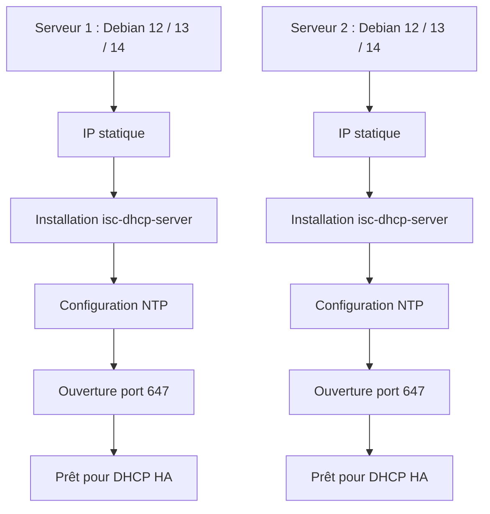
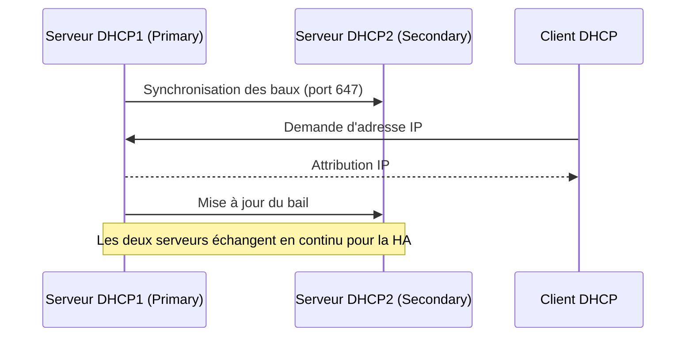

<!-- MASTER-HEADER-START -->
<div align="center">

<a href="https://0xcyberlitech.com/">
  
</a>

<p align="center">
  <a href="https://0xcyberlitech.com/"></a>
  <a href="https://0xcyberlitech.com/soc-rd.html"></a>
  <a href="https://0xcyberlitech.com/jarvis-rd.html"></a>
  <a href="https://github.com/0xCyberLiTech?tab=repositories"></a>
</p>
<p align="center">
  <a href="README.md"></a>
</p>


</div>
<!-- MASTER-HEADER-END -->

<!-- DEBIAN-TRUTH-START -->
> [!IMPORTANT]
>  ** Matrice Officielle Debian — `Debian 12 (Bookworm)` · `Debian 13 (Trixie)` · `Debian 14 (Forky)`**
> - **Sources Officielles Debian.org (`kea`) :** `Bookworm (12)` : **`Stable-12`** &nbsp;·&nbsp; `Trixie (13 — Stable)` : **`Stable-13`** &nbsp;·&nbsp; `Forky (14 — Next-Gen)` : **`Testing-14`**
> - **Références Officielles :** [Paquet Debian Trixie (`kea-dhcp4-server`)](https://packages.debian.org/trixie/kea-dhcp4-server) &nbsp;·&nbsp; [Paquet Debian Forky (`kea-dhcp4-server`)](https://packages.debian.org/forky/kea-dhcp4-server) &nbsp;·&nbsp; [Documentation Officielle Debian](https://wiki.debian.org/DHCP_Server)
> - **Note d'Ingénierie (Divergence 13 vs 14) :** Point de vigilance majeur Debian 13 (Trixie) & Debian 14 (Forky) : `isc-dhcp-server` est déclaré End-of-Life par l'ISC ; Debian recommande désormais officiellement **ISC Kea (`kea-dhcp4-server`)** pour tout nouveau déploiement.

<details>
<summary> <b>Afficher les Encarts Ligne de Commande : Debian 13 (Trixie — Stable) vs Debian 14 (Forky — Next-Gen)</b></summary>

####  Profil Production Stable — Commandes pour `Debian 13 (Trixie)`
```bash
# Debian 13 (Trixie) — Service DHCP (migration officielle d'isc-dhcp-server vers ISC Kea) :
sudo apt update && sudo apt install -y kea-dhcp4-server
sudo systemctl status kea-dhcp4-server && sudo journalctl -u kea-dhcp4-server -n 30
```

####  Profil Anticipation Next-Gen — Commandes pour `Debian 14 (Forky)`
```bash
# Debian 14 (Forky) — ISC Kea DHCPv4/v6 natif (isc-dhcp-server est EoL chez ISC) :
sudo kea-dhcp4 -t /etc/kea/kea-dhcp4.conf
sudo systemctl reload-or-restart kea-dhcp4-server
```

</details>
<!-- DEBIAN-TRUTH-END -->

<!-- CIEL-PEDAGOGY-START -->
<details>
<summary> <b>Synthèse d'Architecture, Standards Officiels &amp; Diagnostic (Niveau 1 : Fondamentaux · Niveau 2 : Repères · Niveau 3 : Diagnostic)</b></summary>

- **Niveau 1 — Fondamentaux &amp; Principe d'Architecture :** Le serveur **DHCP** automatise l'attribution dynamique et centralisée des paramètres IPv4/IPv6 (adresse IP, masque CIDR, passerelle par défaut `option routers`, serveurs DNS et NTP) à chaque équipement du réseau selon le cycle protocolaire **DORA** (*Discover, Offer, Request, Acknowledge*).
- **Niveau 2 — Repères Officiels (Ports IANA, Fichiers Debian &amp; Commandes de Validation) :** **Ports IANA :** `UDP 67` (Serveur) / `UDP 68` (Client) · `TCP 8000` (Agent REST/HA Kea) &nbsp;|&nbsp; **Fichiers Debian :** `/etc/kea/kea-dhcp4.conf` · Baux actifs `/var/lib/kea/kea-leases4.csv` &nbsp;|&nbsp; **Validation officielle :** `sudo kea-dhcp4 -t /etc/kea/kea-dhcp4.conf`.
- **Niveau 3 — Diagnostic d'Incidents &amp; Ingénierie Avancée :** **Diagnostic & Architecture :** En cas d'échec au démarrage, vérifiez que l'interface réseau déclarée possède une IP statique appartenant au sous-réseau distribué. Sous Debian 13/14, `ISC Kea` remplace définitivement `isc-dhcp-server` (EoL) en apportant un moteur JSON, une API REST sans coupure et un failover natif (`libdhcp_ha.so`).
- **Sources de Vérité Officielles Éditeurs &amp; Standards :** [Documentation Officielle ISC Kea (ReadTheDocs)](https://kea.readthedocs.io/) &nbsp;·&nbsp; [RFC 2131 (DHCPv4 IETF)](https://datatracker.ietf.org/doc/html/rfc2131) &nbsp;·&nbsp; [Wiki Officiel Debian DHCP](https://wiki.debian.org/DHCP_Server)
- **Livres Blancs &amp; 67 Podcasts Audio R&amp;D :** [Portail 0xCyberLiTech](https://0xcyberlitech.com/) &nbsp;·&nbsp; [Livre Blanc SOC Cockpit v5.5](https://0xcyberlitech.com/soc-rd.html) &nbsp;·&nbsp; [Livre Blanc JARVIS Mark-VII](https://0xcyberlitech.com/jarvis-rd.html) &nbsp;·&nbsp; [Blueprint Logiciel &amp; Matériel RTX 5080](https://0xcyberlitech.com/blueprint-jarvis.html)

</details>
<!-- CIEL-PEDAGOGY-END -->


##  01 // Mise en place d'une solution DHCP Haute Disponibilité (HA) sous Debian 12 (Bookworm), Debian 13 (Trixie) & Debian 14 (Forky)


---

##  02 // 1. Présentation de la solution DHCP HA


La haute disponibilité (HA) pour DHCP consiste à avoir deux serveurs DHCP synchronisés, capables de prendre le relais en cas de panne de l’un d’eux. Sous Linux (Debian), on utilise généralement le mode "failover" intégré à ISC DHCP.

###  Schéma général


###  Schéma général

---

##  03 // Schéma : Préparation des serveurs




---

##  04 // 2. Préparation des serveurs


###  2.1. Prérequis

**Explications pédagogiques :**
- Le choix de deux serveurs permet de simuler une architecture redondante.
- La synchronisation de l’heure (NTP) est essentielle pour éviter les conflits de baux DHCP.
- L’ouverture du port 647 est indispensable pour la communication failover.

###  2.2. Installation des paquets
Sur les deux serveurs :

<!-- CODE-WINDOW-START -->
> [!CAUTION]
> 
>
> ```bash
> sudo apt update
> sudo apt install isc-dhcp-server
> ```
<!-- CODE-WINDOW-END -->

**Détail :**
- `isc-dhcp-server` est le service le plus utilisé sous Linux pour distribuer des adresses IP dynamiques.
- L’installation doit être réalisée sur les deux serveurs pour garantir la redondance.

---

##  04 // 3. Configuration réseau


Assurez-vous que chaque serveur a une IP fixe sur le même réseau.
Exemple :

**Détail :**
- Une IP fixe est nécessaire pour que les serveurs puissent communiquer et que les clients les identifient.
- Vérifiez la configuration avec `ip a` ou `nmcli`.

---

##  05 // 4. Configuration du DHCP en mode failover


###  4.1. Fichier de configuration principal `/etc/dhcp/dhcpd.conf`

####  Sur dhcp1 :

<!-- CODE-WINDOW-START -->
> [!CAUTION]
> 
>
> ```bash
> failover peer "dhcp-ha" {
>   primary;
>   address 192.168.1.10;
>   port 647;
>   peer address 192.168.1.11;
>   peer port 647;
>   max-response-delay 60;
>   max-unacked-updates 10;
>   load balance max seconds 3;
>   mclt 3600;
> }
>
> subnet 192.168.1.0 netmask 255.255.255.0 {
>   pool {
>     failover peer "dhcp-ha";
>     range 192.168.1.100 192.168.1.200;
>     allow unknown-clients;
>   }
>   option routers 192.168.1.1;
>   option domain-name-servers 8.8.8.8, 8.8.4.4;
> }
> ```
<!-- CODE-WINDOW-END -->

**À faire :**
1. Éditez le fichier `/etc/dhcp/dhcpd.conf` sur chaque serveur.
2. Adaptez les IP selon votre réseau.
3. Vérifiez la syntaxe avec `dhcpd -t`.

**Concept pédagogique :**
Le mode failover permet à deux serveurs DHCP de partager la gestion des baux. Si l’un tombe, l’autre continue à distribuer les adresses.

**Explication des paramètres principaux :**
- `primary` / `secondary` : définit le rôle du serveur.
- `address` / `peer address` : IP des serveurs.
- `mclt` : durée maximale pendant laquelle un serveur peut attribuer un bail sans synchronisation.
- `max-response-delay` : délai maximal de réponse entre les serveurs.
- `load balance max seconds` : équilibre la charge entre les deux serveurs.

####  Sur dhcp2 :

<!-- CODE-WINDOW-START -->
> [!CAUTION]
> 
>
> ```bash
> failover peer "dhcp-ha" {
>   secondary;
>   address 192.168.1.11;
>   port 647;
>   peer address 192.168.1.10;
>   peer port 647;
>   max-response-delay 60;
>   max-unacked-updates 10;
>   load balance max seconds 3;
>   mclt 3600;
> }
>
> subnet 192.168.1.0 netmask 255.255.255.0 {
>   pool {
>     failover peer "dhcp-ha";
>     range 192.168.1.100 192.168.1.200;
>     allow unknown-clients;
>   }
>   option routers 192.168.1.1;
>   option domain-name-servers 8.8.8.8, 8.8.4.4;
> }
> ```
<!-- CODE-WINDOW-END -->

---

###  4.2. Fichier `/etc/default/isc-dhcp-server`
Vérifiez que l’interface réseau est bien renseignée (ex : `INTERFACESv4="eth0"`).

**Astuce :**
Utilisez la commande `ip a` pour identifier l’interface à renseigner.

---

##  06 // 5. Synchronisation des fichiers de baux


Le mode failover synchronise automatiquement les baux via le protocole DHCP. Il n’est pas nécessaire de synchroniser manuellement les fichiers `dhcpd.leases`.

**Explication :**
La synchronisation des baux garantit que les clients ne perdent pas leur adresse IP en cas de bascule. Les serveurs échangent en temps réel les informations de baux.

---

##  07 // Schéma : Flux de synchronisation DHCP Failover




---

##  08 // 6. Démarrage et vérification


Sur chaque serveur :

<!-- CODE-WINDOW-START -->
> [!CAUTION]
> 
>
> ```bash
> sudo systemctl restart isc-dhcp-server
> sudo systemctl status isc-dhcp-server
> ```
<!-- CODE-WINDOW-END -->

Vérifiez les logs pour s’assurer que la synchronisation s’effectue :

<!-- CODE-WINDOW-START -->
> [!CAUTION]
> 
>
> ```bash
> tail -f /var/log/syslog
> ```
<!-- CODE-WINDOW-END -->

Vous devez voir des messages du type "DHCP failover peer dhcp-ha: communications established".

**Conseil pédagogique :**
- Utilisez les logs pour comprendre le dialogue entre les serveurs.
- En cas d’erreur, vérifiez la configuration et la connectivité réseau.

---

##  09 // 7. Test de bascule


  `sudo systemctl stop isc-dhcp-server`

- Vérifiez que dhcp2 continue à distribuer des baux.
- Redémarrez dhcp1 et vérifiez la resynchronisation.

**À observer :**
- Les clients doivent continuer à recevoir des adresses IP.
- Les logs montrent la reprise de la synchronisation.

---

##  10 // Schéma : Test de bascule DHCP HA


Schéma : Test de bascule DHCP HA

<!-- CODE-WINDOW-START -->
> [!CAUTION]
> 
>
> ```bash
> +-------------------+           +-------------------+
> |  DHCP1 (Primary)  |           | DHCP2 (Secondary) |
> |      [OFF]        |           |      [ON]         |
> +-------------------+           +-------------------+
>          |                               |
>          +-------------------------------+
>                          |
>                  +------------------+
>                  |   Clients DHCP   |
>                  +------------------+
> ```
<!-- CODE-WINDOW-END -->

---

##  11 // 8. Schéma de fonctionnement failover


Schéma de fonctionnement failover

<!-- CODE-WINDOW-START -->
> [!CAUTION]
> 
>
> ```bash
> +-------------------+     <---->     +-------------------+
> |  DHCP1 (Primary)  |                | DHCP2 (Secondary) |
> +-------------------+                +-------------------+
>          |                                   |
>          +---------------+-------------------+
>                          |
>                  +------------------+
>                  |   Clients DHCP   |
>                  +------------------+
> ```
<!-- CODE-WINDOW-END -->

---

##  12 // 9. Conseils pédagogiques


- Prenez le temps de comprendre chaque paramètre de la configuration DHCP et failover.
- Testez la bascule en coupant un serveur et observez le comportement des clients.
- Analysez les logs pour suivre la synchronisation et la reprise du service.
- Documentez vos manipulations et résultats pour consolider vos acquis.
- Utilisez des schémas pour visualiser l’architecture et les flux réseau.
- Expérimentez différentes plages d’adresses et options DHCP pour voir leur impact.

---

##  13 // Pour aller plus loin


- Essayez de modifier la plage d’adresses et observez le comportement.
- Ajoutez des réservations d’adresses pour certains clients.
- Simulez une coupure réseau entre les serveurs et analysez les logs.
- Documentez chaque étape avec vos propres commentaires pour renforcer l’apprentissage.

---

##  14 // 10. Ressources complémentaires


- [Documentation officielle ISC DHCP](https://kb.isc.org/)
- [Debian Wiki DHCP](https://wiki.debian.org/DHCP_Server)

<!-- MASTER-FOOTER-START -->
<div align="center">


<a href="https://0xcyberlitech.com/">
  
</a>

<p align="center"><a href="https://0xcyberlitech.com/"></a></p>

<sub><b>Architecturé &amp; Forgé par Marc &amp; Antigravity (Google DeepMind)</b> &nbsp;·&nbsp; <a href="https://0xcyberlitech.com/"><b>0xcyberlitech.com</b></a> &nbsp;·&nbsp; <a href="https://0xcyberlitech.com/soc-rd.html">Architecture SOC Cockpit v5.5</a> &nbsp;·&nbsp; <a href="https://0xcyberlitech.com/jarvis-rd.html">Architecture JARVIS Mark-VII</a> &nbsp;·&nbsp; <a href="https://0xcyberlitech.com/blueprint-jarvis.html">Blueprint Matériel RTX 5080</a></sub>

</div>
<!-- MASTER-FOOTER-END -->
